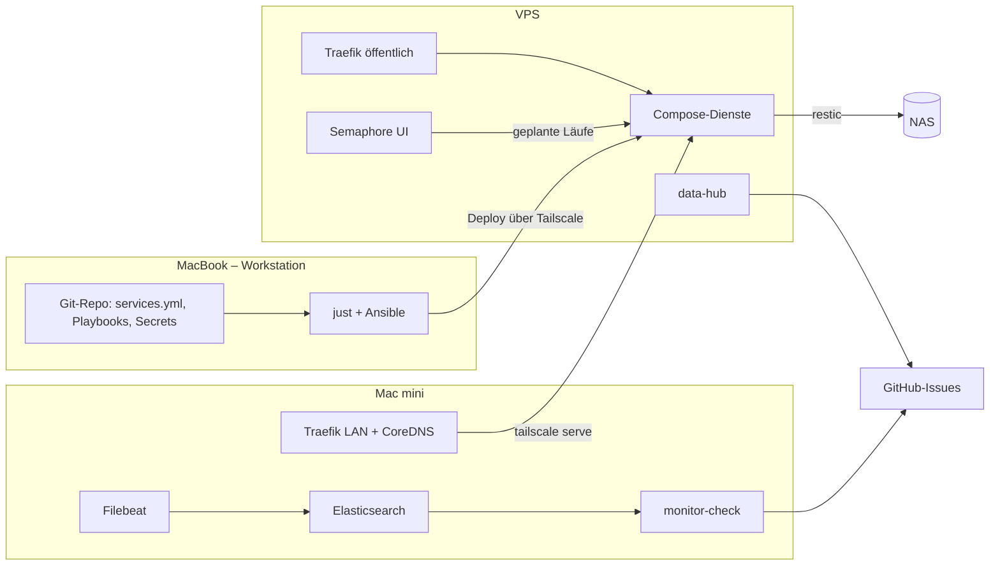
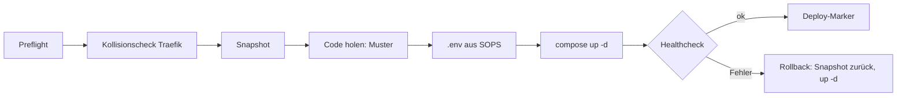
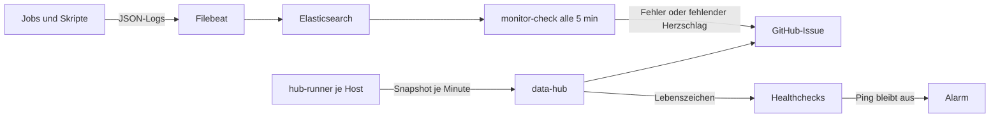

Am 23. Juli 2026 habe ich angefangen, meine selbst betriebenen Dienste in ein
einziges Infrastruktur-Repo zu ziehen. Vorher lagen Compose-Dateien,
Cronjobs und Passwörter verstreut auf drei Rechnern; was wo lief, wusste nur
der jeweilige Rechner. Dieser Artikel zeigt nicht das Repo Datei für Datei,
sondern welche Technologie welche Aufgabe übernimmt und wie die Teile
zusammenspielen – Stand Oktober 2026.

## Hosts: drei Rechner, klare Rollen

| Host             | Rolle                                                          |
| ---------------- | -------------------------------------------------------------- |
| MacBook          | Workstation und Ansible-Controller, hält die lokale CA         |
| Mac mini M4      | Dauerläufer im Heimnetz: LAN-Proxy, DNS, Log-Speicher, Alarm   |
| VPS (Debian 12)  | Öffentliche Dienste, Scheduler, Monitoring-Hub                 |
| NAS              | Ziel der nächtlichen Backups                                   |

Auf dem VPS und dem Mac mini laufen die Dienste als Docker-Compose-Stacks, auf
dem Mini mit OrbStack als Container-Laufzeit. Adressen stehen nicht im Repo,
sondern kommen zur Laufzeit aus der Umgebung.

## Ein Einstieg: just und Ansible

Alles beginnt mit `just`. Die Rezepte sind in Gruppen sortiert (Ausführen,
Prüfen, Ausrollen, Einrichten), und `just --list` ist zugleich die
Werkzeugliste. Ein kleiner Wrapper startet `just` unter `sops exec-env`, damit
jedes Rezept die entschlüsselten Werte in der Umgebung hat, ohne dass sie je
auf der Platte liegen.

Darunter arbeitet Ansible: Playbooks für Checks, Jobs, Runbooks und Deploys,
dazu eine einzige Rolle für das Ausrollen von Diensten. Zwei eigene Plugins
ergänzen es – ein Callback, der jeden Lauf als strukturiertes Log schreibt,
und ein Lookup, der Werte aus verschlüsselten dotenv-Dateien liest.

## Dienste als Deklaration: services.yml und Schema

Jeder Dienst ist ein Git-Submodule unter `<host>-services/<zustand>/<name>`.
Der Pfad allein sagt, auf welchem Host ein Dienst läuft und ob er aktiv ist;
ein Umzug ist ein `git mv`, kein Suchen in Konfigurationsdateien.

Was der Pfad nicht sagt, steht in `services.yml`: Deploy-Muster, Domain,
Health-Pfad, Compose-Datei und welche Secrets in die `.env` gehören. Die Datei
hat Standardwerte und je Dienst nur die Abweichungen. Bevor ein Host berührt
wird, prüft ein JSON-Schema die Struktur und ein Python-Skript die
Vertragsregeln:

- `git-pull` braucht ein Repo, `compose-pull` darf nichts bauen.
- Jeder `./`-Mount muss mitgeliefert werden – sonst legt Docker auf einem
  frischen Host ein leeres Verzeichnis an.
- Ein Dienst mit Domain veröffentlicht keinen Port, weil er sonst an der
  Firewall vorbeiginge.
- Keine Domain doppelt, und ein Health-Pfad nur mit Domain.

## Deploy mit Rückweg

Drei Muster decken alle Dienste ab:

| Muster        | Was passiert                                                     |
| ------------- | ---------------------------------------------------------------- |
| `compose-pull` | Compose-Datei und deklarierte Dateien kopieren, Images ziehen   |
| `git-pull`    | Der Host klont das Dienst-Repo selbst                            |
| `rsync-build` | Submodule per rsync auf den Host, dort wird gebaut               |

Nur das Holen des Codes unterscheidet sich, der Rest ist eine gemeinsame
Strecke. Vor jedem Deploy laufen gitleaks und trivy.

- **Healthcheck:** HTTPS auf die Domain samt Health-Pfad, bis zu zwölf
  Versuche; ohne Domain zählt der Container-Zustand.
- **Rollback:** Snapshot zurückspielen und erneut `up -d` – bewusst nie
  `down`. Ein Rollback, der den Dienst herunterfährt und nicht wieder
  hochbekommt, hat mir einmal zehn Minuten DNS gekostet.
- **„Geändert“** leitet sich aus den Container-IDs vor und nach dem `up` ab,
  nicht aus der Textausgabe von Compose.

## Netz und Zugang: Traefik und Tailscale

- **Öffentlich:** Traefik auf dem VPS leitet HTTP auf HTTPS um, holt
  Zertifikate bei Let's Encrypt und setzt Sicherheits-Header.
- **Privat:** Alles unter der `.lan`-Zone erreicht nur, wer im Tailnet ist.
  Tailscale Split-DNS zeigt auf CoreDNS auf dem Mac mini, dort terminiert ein
  zweiter Traefik TLS mit einem mkcert-Wildcard-Zertifikat. Dienste auf dem
  VPS lauschen dafür nur auf Loopback und werden per `tailscale serve` ins
  Tailnet gereicht.
- **Verwaltung:** Ansible und Semaphore erreichen die Hosts über Tailscale.
- **DNS und Firewall:** Pi-hole mit unbound läuft als eigener Stack; die
  UFW-Regeln stehen in den Gruppen-Variablen, und ein Runbook gleicht sie ab –
  erst hinzufügen, dann löschen, und ohne SSH-Regel verweigert es den Lauf.

Private Werkzeuge ohne eigenes Login liegen grundsätzlich nur im Tailnet. Das
Tailnet ist dort die Zugangskontrolle.

## Secrets: SOPS und age

Secrets liegen verschlüsselt im Repo, mit SOPS und age. Jeder Empfänger hat
einen eigenen Schlüssel: MacBook, Mac mini und ein Deploy-Schlüssel für
Semaphore. Eine Datei hält die Werte des Controllers, eine zweite die Werte,
die vorher als `.env` auf dem VPS lagen.

Welche Werte ein Dienst bekommt, steht in `services.yml` als Zuordnung von
Variablenname zu Schlüssel. Ansible rendert daraus die `.env` und ersetzt
damit Templates, die eigene Passwörter erzeugten – ein Risiko bei jeder
Datenbank, deren Passwort schon im Volume steckt. Ein
gitleaks-Hook verhindert, dass ein Klartext-Secret überhaupt committet wird.

## Auslösen: Semaphore UI

Geplant und von Hand gestartet wird über
[Semaphore UI](https://github.com/semaphoreui/semaphore) auf dem VPS. Projekt,
Templates, Zeitpläne und Umgebungen richtet ein Skript aus einer Job-Liste im
Repo ein – Semaphore wird also selbst deklarativ gepflegt. Ein Template
„Deploy Service“ führt dasselbe Deploy-Playbook aus wie `just`, und andere
Werkzeuge bekommen eigene Tokens mit der Rolle, die nur Läufe starten darf.

Daneben bleibt wenig: ein Cronjob für die Alarmprüfung, ein paar launchd-Agents
auf dem Mac und ein systemd-Timer auf dem VPS.

## Monitoring und Alarm

Jeder Job schreibt ein strukturiertes JSON-Log, und jedes Job-Playbook endet
mit einer Aufgabe, die bei einem Fehler laut scheitert. Daraus wird an zwei
Stellen ein Alarm:

- **Alarmkette:** Filebeat liefert die Logs an Elasticsearch, `monitor-check`
  macht aus Fehlern und ausbleibenden Herzschlägen GitHub-Issues – mit
  Duplikatprüfung und automatischem Schließen nach 24 Stunden.
- **Host-Checks:** Ein kleiner Runner je Host schickt einmal pro Minute einen
  Snapshot an data-hub, einen eigenen Dienst auf dem VPS, der bei Problemen
  ebenfalls ein Issue öffnet.
- **Wer überwacht den Wächter:** data-hub meldet sich regelmäßig bei einer
  selbst gehosteten Healthchecks-Instanz. Bleibt das Lebenszeichen aus,
  schlägt Healthchecks an.

## Backups

- **SQLite:** Täglich sichert ein Job die SQLite-Datenbanken der Dienste mit
  `sqlite3 .backup`, prüft die Integrität und hält 30 Tage vor.
- **Alle Hosts:** Danach läuft eine Backup-Kette mit restic über rclone und SMB
  auf das NAS, für alle drei Rechner, mit 7 täglichen, 4 wöchentlichen und 12
  monatlichen Ständen.
- **Wiederherstellung:** Ein eigener Restore-Test liest regelmäßig aus dem
  Backup zurück – ein Backup, das nie zurückgelesen wurde, ist nur eine
  Annahme.

## Tests

`just lint` führt ansible-lint aus, `just test` gut 300 pytest-Tests über die
Skripte für Deploy, Monitoring und Dienstverwaltung. Auch die Vertragsregeln
für `services.yml` haben eigene Tests.

## Was sich unterwegs geändert hat

- **Juli:** Semaphore übernimmt die Zeitpläne vom alten Cron-Wrapper;
  „geändert“ wird über Container-IDs erkannt.
- **August:** Der Mac mini kommt als Dauerläufer dazu, Elasticsearch und die
  Alarmprüfung ziehen dorthin; alle Secrets vom VPS landen verschlüsselt im
  Repo; die NAS-Sicherung wird entworfen.
- **Oktober:** data-hub ersetzt Checkmk, Kibana fällt weg, und die meisten
  Dienste ziehen vom Mini auf den VPS – das Monitoring soll einen Ausfall des
  Mini überleben.

## Fazit

Kein Teil des Stacks ist exotisch. Den Unterschied macht, dass jede Aufgabe
genau ein Werkzeug hat und jede Übergabe geprüft wird: Schema und
Vertragsregeln vor dem Deploy, Healthcheck und Rollback danach, ein Issue,
wenn etwas schiefgeht – und ein Lebenszeichen, falls das Melden selbst
ausfällt. Wer die Muster ohne meine Dienste ausprobieren will, findet sie in
der Vorlage [iac-stack-template](/projekte/iac-stack-template).
