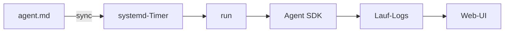

## Was es macht

agent-planner führt geplante Claude-Agenten auf Linux aus: systemd-Timer starten
das Claude Agent SDK, jeder Lauf landet als Log auf der Platte, und eine kleine
Web-Oberfläche mit Hono und htmx zeigt, bearbeitet und startet die Agenten.
Ein Cronjob, der ein Sprachmodell aufruft, lässt offen, ob er lief, was er tat,
was er kostete und was er anfassen darf. agent-planner beantwortet das mit
systemd, Lauf-Logs und der Oberfläche.

## Wie es funktioniert

- Ein Agent ist eine Markdown-Datei: Frontmatter mit Name, Cron-Ausdruck,
  Arbeitsverzeichnis und Grenzen, der Prompt steht im Text.
- `sync` erzeugt daraus systemd-User-Units: je Agent ein Timer, dazu eine
  gemeinsame `oneshot`-Service-Vorlage. Cron-Ausdrücke werden zu `OnCalendar=`
  übersetzt und mit `systemd-analyze` geprüft.
- `run <slug>` führt einen Agenten aus, mit Timeout, Turn-Limit und Budget je
  Agent. Jede SDK-Nachricht wird protokolliert; das Ergebnis ist `success`,
  `error`, `timeout`, `stopped` oder `auth_missing`.
- Bei Fehlern meldet `notify-send` den Lauf.
- Die Oberfläche ist serverseitig gerendert: Übersicht mit nächstem und letztem
  Lauf, Detailseite mit Verlauf und Tool-Aufrufen, Anlegen, Bearbeiten,
  Archivieren und „jetzt ausführen“.

## Stand

TypeScript auf bun, gedacht für einen Nutzer auf einem Linux-Rechner mit
systemd-User-Diensten. Agenten laufen mit den Rechten des Nutzers, und die
Oberfläche hat keinen Login: Sie hört standardmäßig nur auf Loopback, eine
Quell-IP-Liste und die Prüfung des `Host`-Headers schützen weitere Zugriffe.
Die Logs enthalten die volle Agentenausgabe und sind nur für den Nutzer lesbar.
