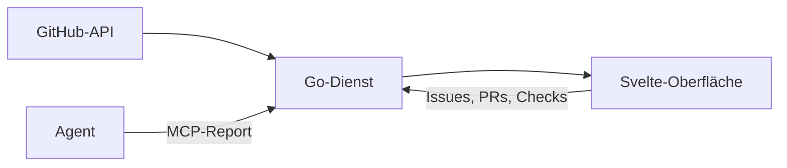

## Was es macht

git-planner-go ist eine Arbeitsansicht über viele Repos: offene GitHub-Issues,
laufende OpenSpec-Changes, Pull Requests und CI-Läufe in einer Oberfläche. Sie
zeigt, was als Nächstes dran ist, was blockiert ist und welche Belege
(Screenshots, Testausgaben) ein Agent zu einer Aufgabe eingereicht hat. Dazu
kommen Epic-Maps, die den Fortschritt eines größeren Vorhabens samt Belegen
zeigen. Gedacht ist sie für einen Ablauf, in dem Coding-Agenten Changes
abarbeiten und ein Mensch den Stand prüft.

## Wie es funktioniert

- Ein Go-Dienst ohne externe Go-Abhängigkeiten. Die Svelte-Oberfläche liegt als
  fertiges Bundle per `go:embed` im Binary. Betrieb als Docker-Container über
  `just deploy`; `go run . --demo` startet mit erfundenen Daten.
- Die Oberfläche ist an die To-do-App Things angelehnt: links die Repos nach
  Bereichen, in der Mitte die offenen Issues in Abarbeitungsfolge über
  `blocked_by`, darunter der zugehörige Change mit den Aufgaben aus `tasks.md`.
  Dazu kommen die Ansichten *Heute* und *Logbuch* über alle Repos.
- Die Daten kommen direkt über die REST- und GraphQL-API von GitHub. Jeder
  Abruf ist bedingt (ETag), die Antwort kommt aus dem Speicher, die Erneuerung
  läuft im Hintergrund – ein Seitenaufruf fragt GitHub nie selbst.
- Aus der Oberfläche heraus lassen sich Issues anlegen und schließen, Blocker
  setzen, Reviews beantworten, PRs mergen und fehlgeschlagene Checks neu starten.
- Ein MCP-Endpunkt nimmt Fortschritts-Reports von Agenten an und legt sie
  append-only als Belege ab.

Es gibt keinen Login: Der Server hört standardmäßig nur auf Loopback. Über
eine weitere Adresse sind Schreibzugriffe gesperrt, bis die Clients freigegeben
sind; für mehr braucht es einen Reverse-Proxy mit Anmeldung.

## Stand

Ein persönliches Werkzeug ohne Stabilitätsversprechen für Flags und Routen; die
Oberfläche und die meiste Dokumentation sind deutsch. Die Auswahl und
Reihenfolge der Aufgaben berechnet Go und ist ohne Browser getestet, die
Oberfläche zeichnet nur.

## Herkunft

Zwei frühere Projekte laufen hier zusammen. Der erste Git Planner (Juli bis
September 2026) war ein GitHub-Dashboard aus Go-Templates und HTMX: Issues über
alle Repos, Agenda, Actions-Tracker, Seiten aus `config.yaml`, mit ETag-Cache in
SQLite, damit ein Poll ohne Neues kein Rate-Limit kostet. Das zweite
Projekt (ab Juni 2026) war ein Go-Port einer früheren Deno-App und eine Ansicht
für Epic-Maps mit Belegen. Seit Ende September läuft das Repo selbst im
OpenSpec-Ablauf: jede Änderung ein Change mit eigenem Issue, Branch und PR,
gehalten von maschinellen Gates. Der Code für beads-Daten bleibt als eine von
mehreren Aufgabenquellen erhalten.
