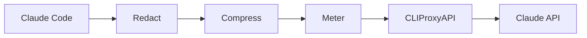

## Was es macht

tollgate ist ein auditierbares Gateway für Aufrufe der Claude-API. Jede Anfrage
von Claude Code läuft durch eine feste Pipeline aus Schwärzung, Kompression,
Messung und Weiterleitung. Jede Stufe protokolliert, was sie geändert hat. Die
Clients tauschen nur eine URL aus; Hooks auf jedem Rechner entfallen.

## Wie es funktioniert

- **Eingang:** prüft den Client-Schlüssel, bevor der Body gelesen wird, und
  bildet daraus mit der Session-ID einen Sitzungsschlüssel.
- **Redact:** ersetzt Secrets und personenbezogene Daten durch nummerierte
  Platzhalter wie `<redacted:email_1>`. Kunden- und Wortlisten sind
  konfigurierbar.
- **Compress:** kürzt nur Bash-Ausgaben (Testläufe, Build-Logs, Diffs,
  Suchergebnisse), nie Dateiinhalte.
- **Meter:** schätzt Token vor dem Weiterleiten und liest `usage` aus dem
  Antwortstrom.
- **Rückweg:** übersetzt die Platzhalter in der Antwort zurück, damit der Client
  Klartext sieht.

Die Regeln, die Code und Tests erzwingen: Jede Umformung ist byteweise
deterministisch, damit der Prompt-Cache gültig bleibt. Schlägt eine Stufe fehl,
wird die Anfrage abgelehnt statt ungefiltert weitergeleitet. Die Zuordnung der
Platzhalter lebt nur im Arbeitsspeicher; Logs und Datenbank enthalten nur
geschwärzte Daten. Der Dienst startet nicht auf einer Wildcard-Adresse.

## Stand

Go mit eingebettetem Svelte-Dashboard und SQLite, Container-Betrieb über
`just setup`. Das Dashboard zeigt jede Anfrage Stufe für Stufe, Verlauf,
Token-Kosten und die Konfiguration mit Versionierung und Probelauf. Die
Schwärzung ist musterbasiert: ein Filter, keine Garantie. Gebaut für einen
Betreiber im privaten Netz, ohne Mandantentrennung.
